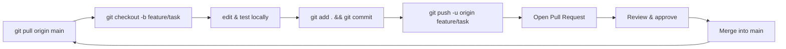

<div align="center">

# 🔁 Git & Collaboration Handbook

**How to push code, work together, and ship a clean repository.**

</div>

---

## 📌 Table of Contents

- [1. Why this handbook exists](#1-why-this-handbook-exists)
- [2. Getting access to the repository](#2-getting-access-to-the-repository)
- [3. One-time Git setup](#3-one-time-git-setup)
- [4. The everyday workflow](#4-the-everyday-workflow)
- [5. Branches](#5-branches)
- [6. Commits and commit messages](#6-commits-and-commit-messages)
- [7. Push, pull and remote tracking](#7-push-pull-and-remote-tracking)
- [8. Pull Requests and code review](#8-pull-requests-and-code-review)
- [9. Resolving merge conflicts](#9-resolving-merge-conflicts)
- [10. What to commit and what not to](#10-what-to-commit-and-what-not-to)
- [11. Working with notebooks](#11-working-with-notebooks)
- [12. Recovering from mistakes](#12-recovering-from-mistakes)
- [13. GitHub issues — planning the work](#13-github-issues--planning-the-work)
- [14. Collaboration etiquette](#14-collaboration-etiquette)
- [15. Cheat sheet](#15-cheat-sheet)
- [16. Troubleshooting](#16-troubleshooting)

---

## 1. Why this handbook exists

Most hackathon time is lost to Git problems, not quantum problems. A team member
who cannot push will block everyone downstream of them.

This handbook is the single source of truth for **how your team should use
Git and GitHub** during the VTU-QFF Hackathon. Read it once, agree on the
workflow with your team, and you will never lose a teammate's work.

**The three rules that matter most:**

1. **Never push directly to `main`.** Work on a branch, open a Pull Request.
2. **Pull before you push.** Keeps `main` current and avoids rejected commits.
3. **Never force-push to `main`.** It can delete your teammates' commits.

---

## 2. Getting access to the repository

Every team member is added to the team's repository as a **collaborator** with
`push` permission by the organisers.

### Accepting your invitation

GitHub sends an invitation **email** to the address on your GitHub account.

1. Look for an email from `noreply@github.com` with subject
   *"You have been invited to collaborate on <repo>"*.
2. Click **Accept invitation**.
3. Or go to <https://github.com/settings/repository/invitations> — pending
   invitations are listed there.
4. After accepting, your username appears under **Settings → Collaborators**.

> ⚠️ **Nothing you push will be accepted until you accept the invitation.**
> If a teammate cannot push, check this first — it is the most common issue.

### Verify your access

```bash
git clone https://github.com/ORG/REPO_NAME.git
cd REPO_NAME
git remote -v
```

If you can clone, you have read access. To confirm write access:

```bash
git push --dry-run origin main
```

---

## 3. One-time Git setup

Do this **once per laptop**:

```bash
# Who you are in the commit history
git config --global user.name  "Your Full Name"
git config --global user.email "you@github.com"

# Nicer diffs
git config --global diff.colorMoved zebra

# Push current branch by default
git config --global push.autoSetupRemote true

# Rebase instead of merge when pulling
git config --global pull.rebase true

# Default branch name
git config --global init.defaultBranch main
```

Check it worked:

```bash
git config --list --global
```

---

## 4. The everyday workflow



As a one-liner:

```bash
git pull origin main
git checkout -b feature/my-task
# ... write code ...
git add .
git commit -m "feat: describe the change"
git push -u origin feature/my-task
# open a Pull Request on GitHub
```

---

## 5. Branches

### Naming

| Type | Pattern | Example |
| :--- | :--- | :--- |
| Feature | `feature/<short-description>` | `feature/vqe-optimization` |
| Fix | `fix/<short-description>` | `fix/encoding-bug` |
| Experiment | `experiment/<short-description>` | `experiment/noise-model` |
| Docs | `docs/<short-description>` | `docs/readme` |
| Chore | `chore/<short-description>` | `chore/deps` |

Keep names lowercase and hyphenated. Avoid `test`, `temp`, `asdf`.

### Creating and switching

```bash
git checkout -b feature/my-task     # create and switch
git switch feature/my-task          # switch to existing (git >= 2.23)
git branch                          # list local branches
git branch -a                       # list local + remote
git checkout main                   # go back to main
git branch -d feature/my-task       # delete local branch after merge
git push origin --delete feature/my-task   # delete remote branch
```

### One branch per person per task

If two people push to the same branch, you will get conflicts. Each teammate
works on **their own branch**. If you must share a branch, coordinate by
pulling before every push.

---

## 6. Commits and commit messages

### Rules of a good commit

- **One logical change per commit.** "Update circuit + fix README + bump deps"
  is three commits.
- **Write the message for a human** — future you, six weeks from now.
- **Commit working code.** Never commit a broken `main`.
- **Test before you commit.**

### Conventional commit format

```text
<type>(<optional scope>): <subject>

<body>

<optional footer>
```

### Types

| Prefix | Use for |
| :--- | :--- |
| `feat:` | New functionality |
| `fix:` | Bug fix |
| `docs:` | Documentation only |
| `test:` | Adding or fixing tests |
| `refactor:` | Restructure, no behaviour change |
| `perf:` | Performance improvement |
| `chore:` | Dependencies, config, tooling |
| `ci:` | CI pipeline changes |

### Examples

```text
feat(circuit): add hardware-efficient ansatz for 4-qubit portfolio problem

fix(encoding): correct bit ordering in the Pauli term mapping

docs: add local run instructions with Aer simulator

chore(deps): pin qiskit>=1.0 and qiskit-aer>=0.15
```

> ⚠️ The subject line is limited to ~72 characters. Start with a lowercase verb
> and **do not** end with a period.

### Useful commands

```bash
git add .                       # stage everything
git add src/circuit.py          # stage one file
git add -p                      # stage selected hunks (interactive)
git status                      # see what is staged
git diff                        # unstaged changes
git diff --staged               # staged changes
git commit -m "message"         # commit
git commit --amend              # fix the last commit
```

---

## 7. Push, pull and remote tracking

```bash
# First push of a branch
git push -u origin feature/my-task

# Later pushes on the same branch
git push

# Update your branch with the latest main
git pull --rebase origin main

# See what changed on the remote
git fetch origin
git log --oneline HEAD..origin/main
```

**If a push is rejected** (`! [rejected] main -> main (fetch first)`), you did
not pull. Fix:

```bash
git pull --rebase origin main
git push
```

### Force-push: know when, know how

```bash
# Only on YOUR OWN branch, and only to rewrite history you published
git push --force-with-lease origin feature/my-task
```

> 🚫 **Never** `git push --force` to `main`. `--force-with-lease` is safer
> because it refuses to overwrite commits you have not seen.

---

## 8. Pull Requests and code review

### Opening one

```bash
git push -u origin feature/my-task
```

Then on GitHub: **Pull requests → New pull request →** choose
`main` ← `feature/my-task` → **Create pull request**.

Or directly:
<https://github.com/ORG/REPO_NAME/compare/main...feature/my-task>

### A good Pull Request

- **Title:** describes the change (`feat: add noise model to simulator`)
- **Description:** what changed, why, and how you tested it
- **Link the issue** it closes (`Closes #12`)
- **Small and focused.** A 300-line PR gets skipped; three 100-line PRs get merged.
- **Screenshots or output** for anything visual or numeric

### Review checklist for the reviewer

- [ ] Does it do what the title says?
- [ ] Does it break anything else?
- [ ] Are there tests? Do they pass?
- [ ] Is the code readable, with no leftover `print()` / debug prints?
- [ ] Are secrets, large files and `__pycache__` excluded?
- [ ] Is the README updated if behaviour changed?

### Merging

- **Require at least one approval** before merging (turn this on in
  `Settings → Branches → Branch protection rules`).
- Prefer **"Squash and merge"** for a clean `main` history.
- **Delete the branch** after merging.

---

## 9. Resolving merge conflicts

A conflict looks like this in your file:

```text
<<<<<<< HEAD
    circuit = ansatz(num_qubits)
=======
    circuit = ansatz(num_qubits, reps=3)
>>>>>>> feature/my-task
```

- `HEAD` = your current branch
- the other side = the incoming branch

### Steps

```bash
git pull --rebase origin main
# git pauses on the conflicting files
```

1. **Open each conflicted file** and fix it by hand — delete the
   `<<<<<<<`, `=======`, `>>>>>>>` markers and keep the correct code.
2. Stage the resolved files:

```bash
git add src/circuit.py
git rebase --continue      # (if rebasing)
# or
git commit                 # (if merging)
```

3. If it gets really messy, abort and start over:

```bash
git rebase --abort
git merge --abort
```

### Avoid conflicts in the first place

- **Pull every day**, before you start and before you push.
- **Keep branches short-lived** — merge within a day or two.
- **Agree on file ownership** — one person per module avoids most clashes.
- **Format your code** (e.g. `black`) so whitespace never causes a conflict.
- **Do not reformat files someone else is actively editing.**

---

## 10. What to commit and what not to

### ✅ Commit

- Source code (`src/`, `notebooks/`)
- `requirements.txt`, `pyproject.toml`
- `README.md` and docs
- `.gitignore`
- Small datasets and fixtures (< 10 MB)

### ❌ Never commit

| Item | Why | Fix |
| :--- | :--- | :--- |
| `.venv/`, `venv/`, `__pycache__/` | Huge, machine-specific | `.gitignore` |
| `.env`, secrets, API keys | Security leak | `.gitignore` + secret manager |
| `*.ipynb` with 50 MB outputs | Bloats history | Clear outputs, `nbstrip` |
| Large datasets | Slow clones | Git LFS or a download script |
| `*.pdf` of papers you do not own | Licensing | Link instead |
| `__pycache__/`, `*.pyc` | Generated | `.gitignore` |

### `.gitignore` to start from

```gitignore
# Python
__pycache__/
*.py[cod]
*.egg-info/
.venv/
venv/
env/
.pytest_cache/
.mypy_cache/
.ruff_cache/

# Jupyter
.ipynb_checkpoints/
*.nbconvert.ipynb

# Environment / secrets
.env
.env.*
*.pem
*.key

# Data / large files
*.h5
*.qasm.out
data/*.csv
!data/sample.csv

# OS / editors
.DS_Store
Thumbs.db
.idea/
.vscode/
```

### Removing a file that was already committed

```bash
# 1. stop tracking it (keep it on disk)
git rm --cached path/to/file
git commit -m "chore: stop tracking generated data"

# 2. add to .gitignore first, then commit that too
```

### If you committed a secret

1. Rotate the key **immediately** — removing it from history is not enough.
2. `git rm --cached <file>`, add it to `.gitignore`, commit.
3. Tell the organisers so the repo can be purged if needed.

---

## 11. Working with notebooks

Notebooks are great for experiments and terrible for diffs.

```bash
pip install nbstrip nbstrip-out
nbstrip --remove-output notebooks/*.ipynb
```

- Clear all outputs before committing (`jupyter nbconvert --clear-output`).
- Commit the **notebook source**, not the rendered output.
- Put reusable logic in `src/*.py` and `import` it from the notebook.
- Restart the kernel and run all cells before you commit — "run all" is the
  only way to be sure it still works.

---

## 12. Recovering from mistakes

| Situation | Command |
| :--- | :--- |
| Uncommitted changes you want to keep | `git stash` → `git stash pop` |
| Wrong commit message | `git commit --amend` |
| Wrong file committed | `git reset --soft HEAD~1` then unstage |
| Want to undo everything locally | `git reset --hard origin/main` |
| Deleted a branch by mistake | `git reflog` → `git checkout -b <sha>` |
| "I overwrote my code" | `git reflog` → find the SHA → `git reset --hard <sha>` |
| Broken merge you want out of | `git merge --abort` |
| Broken rebase you want out of | `git rebase --abort` |

### `git reflog` saves you

`git reflog` lists every position `HEAD` has held — including commits you
thought you lost. Almost nothing is truly gone within 90 days.

```bash
git reflog
# 8f2c1ab HEAD@{2}: commit: feat: the commit I thought I lost
git reset --hard 8f2c1ab
```

> 🚫 `git reset --hard` and `git clean -fd` **delete work**. Read the command
> twice, and only run them when you are certain.

---

## 13. GitHub issues — planning the work

Open an issue the moment you commit to doing something.

- **One issue per task.** "Build VQE for portfolio problem" not "Do quantum stuff".
- **Assign it** to one person.
- **Label** it: `good-first-issue`, `circuit`, `optimizer`, `docs`, `bug`.
- **Reference issues from commits**: `feat: add VQE #12` and close them in the PR.
- **Check the board before starting** — someone may already be on it.

### A useful issue template

```markdown
### What
One line describing the task.

### Why
What breaks / what is missing without it.

### Acceptance criteria
- [ ] Circuit runs on AerSimulator without error
- [ ] Unit test passes
- [ ] Notebooks updated

### Related
Links, papers, other issues.
```

---

## 14. Collaboration etiquette

1. **Say what you are working on** — in the group chat and in an issue.
2. **Pull before you start** — never code on a stale `main`.
3. **Small commits, pushed often** — a lost laptop should cost you an hour, not a day.
4. **Review actively** — a PR that sits for two hours is a PR that gets skipped.
5. **Be kind in review.** Review the code, not the person.
6. **Document as you go** — a comment explaining *why* beats one explaining *what*.
7. **Ask for help early.** A 10-minute question beats a 3-hour block.
8. **Do not merge your own PR without a second pair of eyes** if the team can
   spare one — except in a genuine emergency near the deadline.
9. **Respect the deadline.** Merge a working, documented solution over a
   beautiful, broken one.

### A simple team agreement

Write this down in your team chat at the start:

```text
Branch naming:  feature/<name>
Who owns which file:
  src/circuit.py   -> Alice
  src/optimizer.py -> Bob
  README.md        -> Carol
Review turnaround target: 2 hours
Default branch: main
```

---

## 15. Cheat sheet

```bash
# Setup
git config --global user.name "Your Name"
git config --global user.email "you@github.com"

# Daily loop
git pull origin main
git checkout -b feature/task
git add .
git commit -m "feat: what I did"
git push -u origin feature/task

# Inspect
git status
git log --oneline --graph --all -20
git diff
git diff main...HEAD

# Undo
git restore <file>              # discard changes to one file
git reset --soft HEAD~1         # undo last commit, keep changes staged
git reset --hard origin/main    # discard everything local (careful!)
git stash / git stash pop        # shelve and restore
git reflog                       # find lost commits

# Remote
git fetch --all --prune
git push -u origin <branch>
git push --force-with-lease origin <branch>   # only your own branch
```

---

## 16. Troubleshooting

| Symptom | Likely cause | Fix |
| :--- | :--- | :--- |
| `Permission denied (publickey)` | No SSH key / wrong remote URL | Use the HTTPS URL, or set up SSH |
| `Permission denied` on push | Invitation not accepted | Accept at <https://github.com/settings/repository/invitations> |
| `rejected ... fetch first` | Remote is ahead | `git pull --rebase` then push |
| `Your branch is behind` | Same as above | `git pull` |
| `fatal: not a git repository` | Wrong directory | `cd` into the repo |
| `gh: Not Found (HTTP 404)` | Repo name typo or no access | Check the URL, accept the invite |
| `error: failed to push some refs` | Diverged branches | `git pull --rebase origin main` |
| Files show as modified with no edits | Line endings (CRLF/LF) | `git config --global core.autocrlf input` |
| Huge repo, slow clones | Committed `.venv` or large files | Remove from tracking; add to `.gitignore` |
| `Please tell me who you are` | Git identity not set | `git config --global user.email/user.name` |

### Still stuck?

1. Read the error message **completely** — Git usually tells you the fix.
2. `git status` and `git log --oneline -5` — what state am I actually in?
3. Search the exact error text on <https://stackoverflow.com/questions/tagged/git>.
4. Ask in the team chat — do not spend 40 minutes alone on a Git problem.

---

<div align="center">

**VTU-QFF Guide** · Git & Collaboration Handbook
· Part of the [VTU-QFF Hackathon](https://github.com/vtu-qiskit-fall-fest-2026)

[⬆ Back to Top](#-git--collaboration-handbook)

</div>
